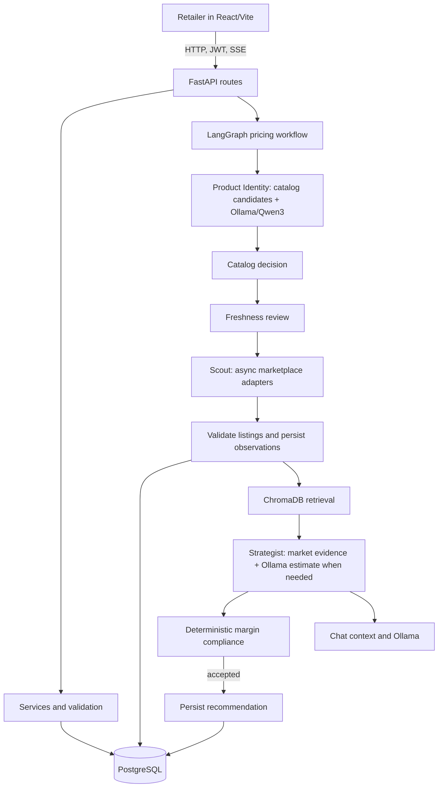

# PricePulse — Agentic AI Pricing Assistant

PricePulse helps small-scale retailers compare their products with marketplace offers and make profit-aware pricing decisions. A React dashboard calls a FastAPI backend that stores retailer, catalog, competitor, analysis, and recommendation data in PostgreSQL. The backend collects marketplace observations, uses Ollama/Qwen3 for product identity and provisional estimates, and uses LangGraph to coordinate the pricing workflow.

## Problem and objectives

Small retailers often have to compare prices manually while keeping their costs and required margins in mind. PricePulse brings product management, competitor collection, market summaries, and explainable recommendations into one application. Recommendations are checked against a deterministic minimum selling-price floor before they are saved.

## Project status

The codebase implements the full application path, but external integrations have different levels of verification:

- **Implemented and covered by automated tests:** authentication and product APIs, product/catalog lifecycle, competitor data and timestamp validation, price history, pricing statistics and margin checks, workflow orchestration behavior, chat conversation persistence, frontend state flows, and canonical PostgreSQL schema contracts.
- **Implemented, with external behavior not guaranteed by tests:** live marketplace scraping, local Ollama inference, and persistent Chroma retrieval. The automated suite mocks or isolates external systems; it does not establish that marketplace pages remain scrapeable or that a particular Ollama host has sufficient resources.
- **Not configured by this repository:** production hosting, a hosted PostgreSQL instance, a hosted Chroma service, or a hosted Ollama service. No deployment is claimed.

## Implemented features

- Retailer registration, login, JWT-protected endpoints, password reset flow, and optional SMTP delivery.
- Retailer products with cost, stock, minimum profit markup, pack quantity, and product details.
- Shared catalog identity review and catalog lifecycle handling.
- Async Playwright collection from Amazon, Flipkart, Myntra, and Meesho adapters, controlled by per-marketplace flags. Site access, selectors, and anti-bot behavior can change; successful scraping is not guaranteed.
- Product and listing checks, URL/title deduplication, quantity reconciliation, optional ratings, and rejection of scraped observations without valid timezone-aware ISO-8601 observation times.
- Competitor upserts and price history with explicit observation provenance. Only qualifying scraper observations are market evidence; manual or legacy rows are not treated as scraped evidence.
- ChromaDB retrieval for product, pricing, chat, and curated business context. PostgreSQL remains the source of truth. Embeddings are generated by the application's deterministic hash embedding function; a separate sentence-transformer model is not used.
- LangGraph pricing workflow with product identity, catalog decision, freshness review, Scout collection, retrieval, strategy, compliance, and recommendation persistence.
- SSE progress events for pricing analysis, acceptance of recommendations, and persisted assistant conversations.
- Docker Compose for a local PostgreSQL, API, and frontend setup. The compose stack expects Ollama to run separately on the host.

## Architecture



The detailed code trace and failure behavior are in [docs/ARCHITECTURE.md](docs/ARCHITECTURE.md).

## Technologies and responsibilities

| Technology | Responsibility |
| --- | --- |
| React 18, Vite, Node test runner | Browser UI, API/SSE requests, frontend tests, static production build |
| FastAPI, Pydantic | HTTP routes, request/response validation, OpenAPI, CORS |
| SQLAlchemy, PostgreSQL, Alembic | Relational persistence and canonical schema migrations |
| Playwright, BeautifulSoup, lxml | Browser-based marketplace collection and HTML parsing |
| LangGraph | Ordered pricing workflow with progress and conditional routing |
| Ollama with `qwen3:8b` | Local model calls for identity, borderline relevance, estimates, and assistant responses |
| ChromaDB | Local persistent semantic retrieval index; PostgreSQL is authoritative |
| Docker Compose | Local PostgreSQL/API/frontend orchestration; Ollama remains external |
| GitHub Actions | PostgreSQL migration contract, backend tests, frontend tests/build, Docker build validation |

## Repository layout

```text
.
├── backend/
│   ├── app/                 # FastAPI app, routes, schemas, models, services
│   ├── scraping/            # Marketplace adapters, parser, Scout, validation
│   ├── alembic/             # Retained legacy migration history
│   ├── alembic_canonical/   # Canonical fresh-install migration graph
│   ├── scripts/             # Database preflight and maintenance tools
│   └── tests/               # Backend and migration regression tests
├── frontend/
│   ├── src/                 # React UI and API/state helpers
│   ├── tests/               # Node test-runner tests
│   └── vercel.json          # SPA route fallback
├── docs/                    # Architecture, deployment, CI, schema notes
├── requirements.txt         # Exact Python runtime/test dependency snapshot
├── docker-compose.yml       # Local PostgreSQL, backend, frontend
└── .env.example             # Safe configuration template; no credentials
```

## Prerequisites

- Python **3.10** (the backend image and GitHub Actions use Python 3.10; the project was developed with a root-level `venv`).
- Node.js **22** and npm, matching the frontend CI runtime.
- PostgreSQL 16 for local execution, or Docker Desktop to run the included PostgreSQL service.
- Ollama installed separately for full local AI behavior, with `qwen3:8b` downloaded.
- Docker Desktop only if using the container workflow.

## Configure local environment

Copy `.env.example` to `backend/.env` for a direct local backend run, then replace the example database URL and local secret with values for your development environment. The backend loads `backend/.env`; do not commit it. If using Docker Compose, the compose file reads repository-root `.env` for `POSTGRES_PASSWORD` and `SECRET_KEY`. Set a strong local password and secret there. Do not put secrets in `VITE_*` variables or commit populated `.env` files.

The example lists backend settings for PostgreSQL, authentication, CORS, frontend reset links, Ollama, ChromaDB, scraper limits/flags, and optional SMTP. Defaults are declared in `backend/app/config.py`; marketplace request timeouts are read by `backend/scraping/scout.py`.

## Start locally with Docker Compose

From the repository root, create a local `.env` containing `POSTGRES_PASSWORD` and `SECRET_KEY` (use local-only values), then run:

```powershell
docker compose up --build -d db
Set-Location backend
docker compose -f ..\docker-compose.yml run --rm backend alembic -c alembic_canonical.ini upgrade head
Set-Location ..
docker compose up --build
```

The first command starts PostgreSQL. The migration command runs the canonical fresh-install path. The final command starts the database, API, and frontend. Compose stores PostgreSQL and Chroma data in named Docker volumes. Ollama is not included in Compose; set its host URL in the root `.env` if model features should work in the backend container (`http://host.docker.internal:11434` is the Compose default). The frontend is available at `http://localhost:5173` and the API at `http://localhost:8000`.

## Run services directly

1. Start PostgreSQL 16 (for example, `docker compose up -d db` from the repository root).
2. Configure `DATABASE_URL` and `SECRET_KEY` in `backend/.env` or the process environment.
3. From `backend/`, use the existing root virtual environment:

   ```powershell
   ..\venv\Scripts\python.exe -m pip install -r ..\requirements.txt
   $env:DATABASE_URL="postgresql+psycopg2://pricepulse:<password>@localhost:5432/pricepulse"
   ..\venv\Scripts\python.exe scripts\db_preflight.py preflight
   ..\venv\Scripts\alembic.exe -c alembic_canonical.ini upgrade head
   ..\venv\Scripts\python.exe scripts\db_preflight.py verify-canonical
   ..\venv\Scripts\python.exe -m uvicorn app.main:app --reload
   ```

4. In another terminal, from `frontend/`:

   ```powershell
   npm ci
   npm run dev
   ```

The backend defaults to `http://127.0.0.1:11434` for Ollama. Run `ollama pull qwen3:8b` and ensure the server is reachable. From a Docker container, use the host-accessible address instead. Model calls can take up to the configured timeout. The app can start without Ollama, but AI-dependent workflow stages may fail or return an unavailable estimate.

## Database migrations

Use `backend/alembic_canonical.ini` and `backend/alembic_canonical/` for a new PostgreSQL database. From `backend/`, the normal fresh-install command is:

```powershell
..\venv\Scripts\alembic.exe -c alembic_canonical.ini upgrade head
```

The canonical graph is separate from the retained legacy graph in `backend/alembic/`. For an existing database, first run `python scripts/db_preflight.py preflight` against the intended database and review every finding. Do not use the adoption command unless the database is explicitly eligible and the adoption process has been reviewed. Never run migrations against production as a local validation step.

## Configuration reference

| Variable | Purpose |
| --- | --- |
| `DATABASE_URL` | PostgreSQL SQLAlchemy connection string; required by backend imports and runtime |
| `SECRET_KEY` | JWT signing secret |
| `ALGORITHM`, `ACCESS_TOKEN_EXPIRE_MINUTES` | JWT algorithm and token lifetime |
| `CORS_ORIGINS` | Comma-separated exact browser origins allowed by credentialed CORS |
| `FRONTEND_BASE_URL` | Primary frontend origin used in reset links (`FRONTEND_URL` remains a compatibility alias) |
| `OLLAMA_BASE_URL`, `OLLAMA_MODEL` | Ollama server and model name; defaults to local `qwen3:8b` |
| `OLLAMA_TIMEOUT`, `OLLAMA_IDENTITY_TIMEOUT`, `OLLAMA_RELEVANCE_TIMEOUT`, `OLLAMA_STRATEGIST_TIMEOUT` | Positive timeouts in seconds for model operations |
| `CHROMA_PERSIST_DIRECTORY` | ChromaDB on-disk persistence directory |
| `SCRAPE_FRESHNESS_THRESHOLD_DAYS`, `MAX_DETAIL_PRODUCTS`, `PLAYWRIGHT_TIMEOUT`, `SCRAPE_DELAY_MS` | Scraping limits and freshness policy |
| `MARKETPLACE_TIMEOUT_SECONDS`, `AMAZON_MARKETPLACE_TIMEOUT_SECONDS` | Bounded platform collection timeouts |
| `SCRAPER_DEBUG`, `SCRAPER_AMAZON_ENABLED`, `SCRAPER_FLIPKART_ENABLED`, `SCRAPER_MYNTRA_ENABLED`, `SCRAPER_MEESHO_ENABLED` | Scraper diagnostics and per-marketplace switches |
| `SMTP_HOST`, `SMTP_USE_SSL`, `SMTP_USE_TLS`, `SMTP_PORT`, `SMTP_USERNAME`, `SMTP_PASSWORD`, `SMTP_FROM_EMAIL` | Optional password-reset email delivery; configure all required connection/account fields |
| `VITE_API_URL` | Frontend build-time API base URL; public in the compiled bundle |
| `POSTGRES_DB`, `POSTGRES_USER`, `POSTGRES_PASSWORD` | Local Compose PostgreSQL initialization values |

## Scraping and data limitations

The adapters exist for Amazon, Flipkart, Myntra, and Meesho. Scraping is subject to each marketplace's availability, markup changes, rate limits, bot detection, and terms. The code validates and records observations but cannot guarantee current coverage or that every request returns offers. Only valid observations with an explicit timezone-aware timestamp qualify as scraped evidence; failed or invalid results are not turned into fabricated observations. Ratings can be missing and remain `None`; invalid ratings are normalized to `None`.

## Testing and validation

Use the root virtual environment for backend work. From `backend/`:

```powershell
..\venv\Scripts\python.exe -m pip check
..\venv\Scripts\python.exe -c "from app.main import app; print(app.title)"
..\venv\Scripts\python.exe -m pytest -ra
```

The canonical PostgreSQL migration regression requires a disposable PostgreSQL database configured through `PRICEPULSE_TEST_DATABASE_URL`; tests skip that integration when it is not set. Frontend commands from `frontend/`:

```powershell
npm ci
npm test
npm run build
```

Do not point test or migration commands at a real user database. The suite mocks external Ollama and marketplace behavior and does not validate live site access.

## Docker

The backend Dockerfile uses Python 3.10, installs the root dependency snapshot and Playwright Chromium system dependencies, and starts `uvicorn app.main:app` on the injected `PORT`. The frontend image builds Vite assets and serves them with unprivileged Nginx. Docker Compose keeps PostgreSQL and Chroma data in named volumes; Ollama must be run separately. See [docs/DEPLOYMENT.md](docs/DEPLOYMENT.md) for hosted setup requirements.

## GitHub Actions

The CI workflow validates a canonical PostgreSQL fresh install and schema contract, runs backend pytest, runs frontend tests and a production Vite build, and builds both Docker images without publishing them. CI uses an isolated PostgreSQL service and test-only settings. The separate release workflow packages artifacts for version tags; it does not deploy the application. See [docs/CI_CD_GUIDE.md](docs/CI_CD_GUIDE.md).

## Current limitations and future work

- Marketplace HTML and anti-bot behavior change, so scraper maintenance is ongoing.
- Full AI workflow requires a reachable Ollama server and sufficient compute for `qwen3:8b`.
- ChromaDB currently uses a local persistent client and needs durable storage in hosted deployments; PostgreSQL remains authoritative.
- Email delivery is disabled unless SMTP is configured.
- Deployment automation and production hosting are not configured.
- Useful future work includes live integration monitoring, scraper health dashboards, backup/restore drills, remote Chroma support if needed, and deployment-specific operational alerts.

## Student-demo deployment architecture

A Vercel multi-service project can declare the Vite frontend and existing Python 3.10 Docker backend together using the root [vercel.json](vercel.json). PostgreSQL and Ollama/Qwen3:8b still require separate hosted services, and ChromaDB's local persistent storage is not durable on Vercel containers. Leave `VITE_API_URL` unset for same-origin API calls and configure backend secrets and `CORS_ORIGINS` in the service environment. Playwright scraping and long-running analysis may be constrained by Vercel service limits. See [docs/DEPLOYMENT.md](docs/DEPLOYMENT.md) for configuration and blockers; no deployment is claimed.
