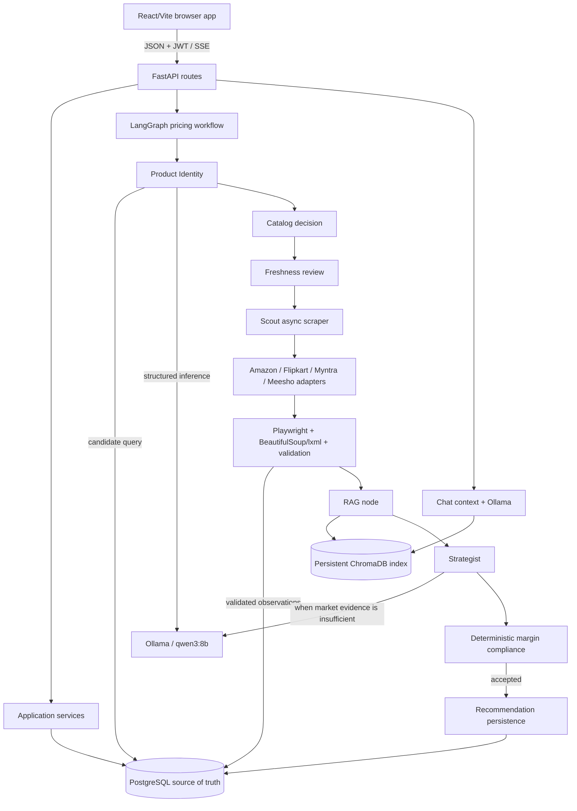

# PricePulse architecture and code flow

This document follows the implementation currently in `backend/app`, `backend/scraping`, and `frontend/src`. It describes code paths and boundaries; it does not claim that external marketplace sites or a production deployment have been verified.

## Runtime overview

## Frontend flow

`frontend/src/main.jsx` contains the application screens and interactions. It implements registration/login and password-reset states, restores the JWT from browser storage, loads the authenticated user/products/recommendations, and lets the retailer create, edit, select, and delete retailer products. Pricing analysis calls `streamPricingWorkflow` in `frontend/src/api.js`, consumes server-sent progress/result/error events, and renders pricing, evidence, market statistics, workflow status, and recommendation acceptance. The same API module handles chat conversation creation/loading and message submission. API calls use build-time `VITE_API_URL`, falling back to `http://localhost:8000`.

The frontend is a single React entry file plus small state helpers (`authState.js`, `chatState.js`, and `productListState.js`); routes are handled as application state and URL paths, with `frontend/vercel.json` providing the static SPA fallback.

## Backend routes, validation, and persistence

`backend/app/main.py` creates the FastAPI app, installs request/error handlers and explicit credentialed CORS, and mounts authentication under `/auth` and the application router under `/api`. `/health` runs `SELECT 1` against PostgreSQL. `backend/app/routes/api.py` groups product, catalog, competitor, pricing, recommendation, agent-log, and workflow routes.

Authentication routes register and log in users, expose the current user, and provide forgot/reset password endpoints. Authenticated application routes obtain the current user through the auth service and scope retailer-owned resources to that user. Route schemas in `backend/app/schemas/` validate and serialize API payloads; service modules hold catalog, product, competitor, pricing, recommendation, and reset-email operations.

SQLAlchemy models are in `backend/app/models/`. Main tables are `users`, `product_catalog`, `retailer_products`, `competitor_products`, `competitor_price_history`, `price_analysis`, `recommendations`, `agent_logs`, `chat_conversations`, and `chat_messages`. A catalog product can have multiple retailer products and competitor observations. Retailer products belong to a user and catalog row; recommendations, analyses, and agent logs belong to a retailer product. Chat conversations belong to a retailer and may optionally reference a retailer product; messages belong to a conversation. PostgreSQL is authoritative for these records.

## Product and competitor data

Creating a retailer product records its owner, cost, stock, required minimum profit markup, and optional package quantity/details. Product/catalog services create or resolve the shared catalog identity while preserving retailer-specific overrides and ownership. Product identity can be marked pending/staged for later model-based resolution.

The workflow checks the retailer product's catalog identity, then records marketplace statuses and calls `scrape_product` from `backend/app/services/scraping_service.py`. Validated listings are upserted in `competitor_products` using a stable catalog/platform/normalized-URL identity; price changes add `competitor_price_history` rows. Scraper observation timestamps are validated before scraped records are persisted. The actual observation time and `SCRAPE` provenance travel with evidence; manual and legacy rows are distinguishable and are not automatically accepted as scraped evidence. Freshness calculations use persisted observation times and the configured threshold.

## Scraping flow

`backend/scraping/scout.py` coordinates enabled platform runners sequentially and asynchronously. Each adapter in `amazon_scraper.py`, `flipkart_scraper.py`, `myntra_scraper.py`, and `meesho_scraper.py` uses Playwright async APIs for browser work; parsers use BeautifulSoup with `lxml`. The pipeline normalizes titles/URLs, removes duplicate candidates, applies lexical and model-assisted relevance filtering, limits result counts, parses quantity evidence, and calls `backend/scraping/validator.py`.

Validation requires platform/title/URL/positive price and a valid timezone-aware ISO-8601 `scraped_at`. Missing, malformed, or timezone-naive timestamps reject the candidate. Missing ratings stay `None`; invalid/out-of-range ratings normalize to `None`. A rejected scrape result cannot become observed competitor evidence. Actual live access remains dependent on marketplace behavior, network access, and anti-bot systems; tests exercise parsers and mocked boundaries rather than guarantee live scraping.

When scraping raises, the pricing workflow rolls back the current DB transaction and evaluates already stored qualifying observations as stale fallback when available. It does not manufacture a new observation time. Marketplace statuses are returned to the UI.

## Semantic retrieval

`backend/app/services/ai/chroma_service.py` lazily opens a `chromadb.PersistentClient` under `CHROMA_PERSIST_DIRECTORY` (default repository `chroma_db`). It maintains pricing, product, chat, and business-knowledge collections. The custom deterministic `_HashEmbedding` produces embeddings locally; the project does not load BGE, SentenceTransformers, or a hosted embedding model. Retrieval adds context for the workflow/chat, but does not replace relational storage or determine product identity on its own. The recommendation write to PostgreSQL occurs before optional recommendation indexing, and that indexing is best-effort. Persistent deployment requires a durable disk; the code currently configures a local persistent client rather than a remote Chroma endpoint.

## LangGraph agent workflow

`backend/app/services/pricing_workflow.py` builds a compiled `StateGraph` with these nodes and order:

1. **Product Identity (`identity`)** loads the retailer product and retrieves PostgreSQL catalog candidates; `product_identity_service.py` uses deterministic checks and structured Ollama output to classify identity when required.
2. **Catalog decision (`catalog_decision`)** applies the identity decision to a shared catalog entry, reusing or creating a row and updating the retailer product link.
3. **Freshness (`freshness`)** reads stored observation freshness and marketplace status. The current route proceeds to Scout unless the workflow has an error.
4. **Scout (`scout`)** invokes async scraper methods through the scraping service, then selects current valid scraper observations or stored stale fallback evidence.
5. **RAG (`rag`)** indexes the current catalog, competitors, and retailer product, then retrieves relevant context from ChromaDB.
6. **Strategist (`strategist`)** checks product relevance and pack comparability, computes deduplicated market statistics, and selects a recommendation strategy. With at least three comparable offers from at least two marketplaces it can use market-backed evidence; otherwise it requests a provisional local Ollama estimate. Model estimates are labeled separately from observed market data.
7. **Compliance (`compliance`)** deterministically checks the recommended price against the minimum profitable selling-price floor and caps confidence by evidence type.
8. **Persistence (`persistence`)** saves only accepted recommendations to PostgreSQL, then attempts best-effort Chroma indexing.

The graph emits progress callbacks around nodes and supports cooperative cancellation at node boundaries. Identity errors and failed compliance can stop the graph before recommendation persistence. Scrape errors are handled inside the Scout node and can leave usable prior data available as stale evidence.

## Pricing and profitability checks

The minimum viable selling price is based on the retailer's cost price and configured minimum profit markup. Comparable marketplace offers are filtered for product identity and quantity uncertainty, normalized to the retailer's target pack where possible, and deduplicated before calculating market statistics such as median, typical range, outliers, and marketplace counts. Sufficient comparable market evidence can drive a market-backed recommendation; otherwise the Strategist may use Ollama for a clearly labeled estimate. The separate Compliance node rejects invalid prices or prices below the minimum floor before the recommendation can be persisted. The result includes evidence type, market statistics, confidence, reasoning, and ranges when available.

## Chat and failure boundaries

Chat endpoints persist conversations and messages in PostgreSQL, retrieve relevant business/product/pricing context, and call Ollama for generated answers. Some direct responses are constructed from persisted product or recommendation data. The backend returns user-facing errors rather than exposing raw server exceptions. If Ollama is unavailable, model-dependent identity/relevance/strategy/chat behavior can fail or become unavailable; deterministic checks still exist but do not replace every model-dependent step. If Chroma indexing for a saved recommendation fails, the PostgreSQL recommendation remains stored. Chroma retrieval initialization errors in earlier workflow steps can still prevent that workflow from completing.

## Database migration paths

`backend/alembic_canonical.ini` and `backend/alembic_canonical/` define the canonical fresh-install schema. Run `alembic -c alembic_canonical.ini upgrade head` from `backend/` against a new PostgreSQL database, then `python scripts/db_preflight.py verify-canonical`. `backend/alembic.ini` and `backend/alembic/` retain the legacy migration graph for historical installations. For an existing database, `backend/scripts/db_preflight.py preflight` is read-only; adoption is a separate explicit operation and requires a reviewed safety decision. Do not treat the ORM models as a replacement for the frozen canonical migration contract.

## Verification boundaries

Automated backend tests cover isolated database/service contracts, parsers, async scraper interfaces, workflow decisions, and mocked external services. CI's PostgreSQL job exercises a fresh canonical migration and schema contract. These checks do not certify live marketplace access, model quality, hosted Chroma durability, production capacity, or deployment configuration.
